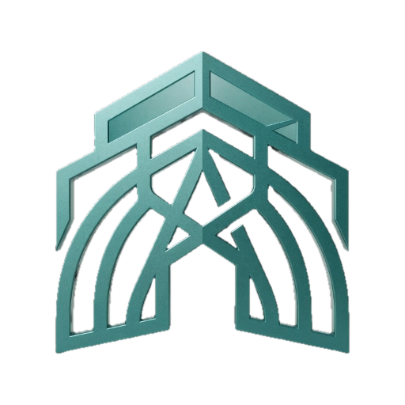
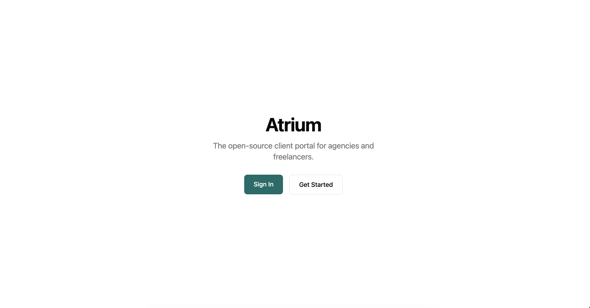

<p align="center">
  
</p>

<h1 align="center">Atrium</h1>

<p align="center"><strong>A self-hosted client portal for agencies and freelancers.</strong></p>

[Website](https://atrium.vibralabs.co) | [Documentation](docs/configuration.md) | [GitHub Issues](https://github.com/Vibra-Labs/Atrium/issues)

Created by [@edgarjc](https://github.com/edgarjc) -- Built out of frustration with the tools I was using to manage client work.

[](https://www.elastic.co/licensing/elastic-license)




## Why Atrium?

Most agencies juggle shared drives, spreadsheets, and scattered emails to keep clients in the loop. Atrium replaces all of that with a single branded portal your clients can log into -- no more "can you resend that file?" emails. Unlike managed SaaS platforms, you own the data and host it yourself.


## Features

### Client portal
- **Branded portal** -- Clients log in to a portal with your logo, colors, branded login page, and optionally your own domain with automatic SSL
- **Projects & updates** -- Post progress updates with images and embedded content (YouTube, Loom, Figma, Google Docs, Canva, and more); clients see a clear current status
- **Files & links** -- Upload deliverables or link external content (Nextcloud, Drive, Notion); stored on local disk, S3, MinIO, or Cloudflare R2
- **Tasks & client requests** -- Task board with statuses, assignees, labels, and drag-and-drop ordering; clients can submit requests from the portal
- **Comments & notifications** -- Threaded discussion on updates and tasks, with in-app, email, and web push notifications
- **View as customer** -- Preview the portal exactly as a client sees it, with mutations blocked

### Get paid
- **Invoicing** -- Draft, send, and track invoices with PDF generation and in-app preview
- **Online payments** -- Clients pay invoices via Stripe Checkout (Direct Keys or Connect)
- **Time tracking** -- Timers and manual entries per project and task, hourly rates, and one-click invoices from un-invoiced time
- **Reports** -- Time reports by project, user, and task, with CSV export

### Contracts & approvals
- **Documents** -- Send quotes, contracts, and NDAs for client acknowledgement or approval
- **E-signatures** -- Signature fields, signing order, reminders, expiry, and a signed certificate with full audit trail
- **Decisions** -- Ask clients to vote on options directly in the portal

### Run the agency
- **Calendar** -- Tasks, project dates, and invoice due dates on a month grid or agenda
- **Team & roles** -- Invite owners and admins to your team; clients join as members with access to their projects only
- **Multiple organizations** -- Run several companies from one install and switch between them; close public signups with `ALLOW_SIGNUPS=false`
- **Global search** -- Full-text search across projects, files, tasks, clients, and updates
- **Tags & labels** -- Cross-entity labels for projects, tasks, files, and people
- **Internal notes** -- Admin-only notes on each project
- **Data export** -- CSV export for projects, invoices, people, tasks, and time entries

### Platform
- **MCP server** -- Connect Claude, ChatGPT-style agents, or local models to manage your workspace via OAuth sign-in or API keys ([docs](docs/mcp.md))
- **Authentication** -- Email/password and magic link via Better Auth; admins can issue password reset links
- **Dark mode** -- Per-user toggle, follows the system by default
- **Email** -- Resend or any SMTP server, configurable per organization
- **Self-hosted** -- Single Docker image with bundled Postgres option, Unraid template, ARM support; optional anonymous crash reporting ([Telemetry](docs/telemetry.md))

## Tech Stack

| Layer     | Technology                  |
|-----------|-----------------------------|
| API       | NestJS 11                   |
| Frontend  | Next.js 15, React 19        |
| Database  | PostgreSQL 16, Prisma ORM   |
| Auth      | Better Auth                 |
| Styling   | Tailwind CSS                |
| Email     | Resend + React Email        |
| Monorepo  | Turborepo + Bun             |

## Getting Started

### Local Development

**Prerequisites:** [Bun](https://bun.sh) (v1.0+) and [Docker](https://docs.docker.com/get-docker/) (for PostgreSQL).

```bash
git clone https://github.com/Vibra-Labs/Atrium.git
cd atrium
bun install
bun run setup
bun run dev
```

This starts the web app at [localhost:3000](http://localhost:3000) and the API at [localhost:3001](http://localhost:3001). The `setup` script handles env files, database, and seed data automatically.

### Docker (Production)

A pre-built image is available on Docker Hub:

```bash
docker pull vibralabs/atrium:latest
```

The quickest way to run Atrium with PostgreSQL:

```bash
curl -O https://raw.githubusercontent.com/Vibra-Labs/Atrium/main/docker-compose.yml
BETTER_AUTH_SECRET=$(openssl rand -base64 32) \
POSTGRES_PASSWORD=your-secure-password \
docker compose up -d
```

Or build from source:

```bash
git clone https://github.com/Vibra-Labs/Atrium.git
cd atrium
docker compose up --build -d
```

The unified image (`vibralabs/atrium`) bundles the API, web app, and a Caddy reverse proxy into a single container on port 8080. It works with any container platform — Docker Compose, Coolify, Portainer, Unraid, etc.

### First Use

1. Open [localhost:3000/signup](http://localhost:3000/signup) and create your account
2. Create projects, upload files, and manage statuses from the **dashboard**
3. Invite clients by email -- they access the **client portal** at `/portal`

## Documentation

- [Docker Deployment](docs/docker.md)
- [Portainer](docs/portainer.md)
- [Unraid](docs/unraid.md)
- [MCP Server](docs/mcp.md)
- [Configuration & Environment Variables](docs/configuration.md)
- [Stripe Payments Setup](docs/stripe.md)
- [Development Guide & Scripts](docs/development.md)
- [Security](docs/security.md)

## Roadmap

Recurring invoices, SAML/SSO and 2FA, webhooks, workflow automations, and more. See the full [Roadmap](docs/roadmap.md).

## Contributing

Contributions are welcome! Here's how to get involved:

1. **Open an issue first** -- Whether it's a bug report, feature idea, or improvement, start with a [GitHub Issue](https://github.com/Vibra-Labs/Atrium/issues) so we can discuss before you write code.
2. **Keep PRs focused** -- Small, single-purpose pull requests are easier to review and merge.
3. **Bug fixes and improvements welcome** -- New features should be discussed in an issue first to make sure they align with the project direction.

## Community & Support

- **Bug reports & feature requests** -- [GitHub Issues](https://github.com/Vibra-Labs/Atrium/issues)
- **Questions & discussions** -- [GitHub Discussions](https://github.com/Vibra-Labs/Atrium/discussions)

If you find Atrium useful, consider giving it a star -- it helps others discover the project.

## License

Atrium is source-available software licensed under the [Elastic License 2.0 (ELv2)](LICENSE). You are free to use, modify, and self-host Atrium. The license restricts offering it as a managed service to third parties.
